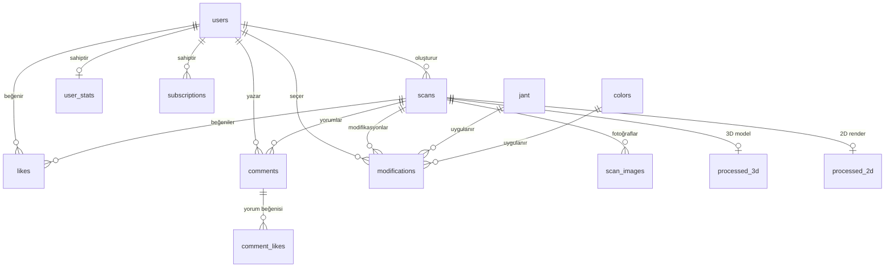
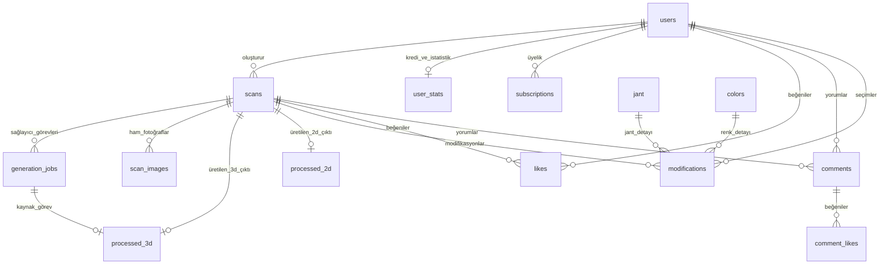

# MODIF-AI Hedef Veritabanı ve Mimari Tasarım Önerisi (Step 3)

> **Özet:** Bu doküman, eski yerel 3D worker yapısından Tripo API doğrudan entegrasyonuna geçiş için önerilen temiz veritabanı şemasını, yeni `generation_jobs` tablosunu ve ilişkileri sunar. Onayınız alındıktan sonra Step 4 (uygulama) aşamasına geçilecektir.

---

## 1. Veritabanı Varlık-İlişki Diyagramı (ERD) — Önce ve Sonra

### 1.1. Önceki Durum (Eski Karmaşık Yapı)
Eski yapıda `scans` tablosu üzerinde yerel Python işçisinin (3Dservice worker) kiralama, token, sayaç ve heartbeat verileri tutuluyordu. Çoklu iş türleri (texture, segmentation) tek bir satıra sıkıştırılmıştı.



### 1.2. Yeni Hedef Tasarım (Temizlenmiş ve Tripo API Uyumlu)
Yeni yapıda harici sağlayıcı (Tripo) işleri bağımsız bir `generation_jobs` tablosunda takip edilir. Bir araç taraması birden fazla sağlayıcı görevine (örneğin önce 3D model üretimi, sonra kaplama/texture, sonra parçalama/segmentasyon) sahip olabilir.



---

## 2. Tablo Karşılaştırmaları ve Yapılacak Değişiklikler

### 2.1. `scans` Tablosu Temizliği
Mobil uygulamanın ihtiyaç duyduğu alanlar korunur; eski 3D servis işçisine ait ölü alanlar kaldırılır:

| Sütun Adı | Tür | Durum | Açıklama |
| :--- | :--- | :--- | :--- |
| `scan_id` | Integer (PK) | **KORUNDU** | Birincil anahtar. |
| `user_id` | Integer (FK) | **KORUNDU** | Aracı yükleyen kullanıcı. |
| `method` | String | **KORUNDU** | "2d", "3d", "3d_single". |
| `status` | String | **KORUNDU** | "pending", "processing", "completed", "failed", "plugin_selected". |
| `car_name` | String | **KORUNDU** | Araç adı. |
| `description`| String | **KORUNDU** | Kullanıcı açıklaması. |
| `is_shared` | Boolean | **KORUNDU** | Toplulukta paylaşıldı mı? |
| `created_at` | DateTime | **KORUNDU** | Oluşturulma tarihi. |
| `progress` | Integer | **STANDARTLAŞTIRILDI** | Eski `progress_percent` alanı temizlenip mobil istemci için `progress` (0-100) olarak tutulur. |
| `error_code` | String(100) | **KORUNDU** | Uygulamanın göstereceği hata kodu (örn: `IMAGE_QUALITY_LOW`). |
| `error_hint` | String(500) | **KORUNDU** | Kullanıcıya gösterilecek dostça ipucu mesajı. |
| `updated_at` | DateTime | **EKLENDİ** | Veritabanı saatine göre son güncelleme zamanı (`func.now()`). |
| ~~`claimed_by`~~ | String | **SİLİNDİ** | Eski worker kiralama alanı. |
| ~~`claim_token`~~| String | **SİLİNDİ** | Eski worker sahiplik jetonu. |
| ~~`retry_count`~~| Integer | **SİLİNDİ** | Eski worker deneme sayısı (yeni yapıda `generation_jobs.attempts` içinde). |
| ~~`failed_step`~~ | String | **SİLİNDİ** | Eski worker hata adımı. |
| ~~`error_detail`~~| String | **SİLİNDİ** | Ham hata detayı (kullanıcıya değil `generation_jobs` tablosuna gidecek). |
| ~~`progress_stage`~~| String | **SİLİNDİ** | Eski worker aşama adı. |
| ~~`next_attempt_at`~~| DateTime| **SİLİNDİ** | Eski worker yeniden deneme bekleme süresi. |
| ~~`status_updated_at`~~| DateTime| **SİLİNDİ** | Yerine standart `updated_at` kullanılacak. |

---

### 2.2. Yeni Tablo: `generation_jobs` (Sağlayıcı Görevleri)
Her ücretli sağlayıcı çağrısı (Tripo API) için tam olarak bir satır açılır.

```sql
CREATE TABLE generation_jobs (
    job_id SERIAL PRIMARY KEY,
    scan_id INTEGER NOT NULL REFERENCES scans(scan_id) ON DELETE CASCADE,
    provider VARCHAR(50) NOT NULL DEFAULT 'tripo',
    task_type VARCHAR(50) NOT NULL, -- 'text_to_3d', 'image_to_3d', 'multiview_to_3d', 'texture', 'segmentation'
    provider_task_id VARCHAR(100) UNIQUE, -- Tripo'nun döndüğü task UUID
    status VARCHAR(50) NOT NULL DEFAULT 'pending', -- 'pending', 'running', 'success', 'failed', 'cancelled'
    credits_used INTEGER NOT NULL DEFAULT 0,
    attempts INTEGER NOT NULL DEFAULT 1,
    error_code VARCHAR(100),
    error_hint VARCHAR(500),
    error_detail VARCHAR(1000),
    progress INTEGER NOT NULL DEFAULT 0,
    started_at TIMESTAMP WITH TIME ZONE,
    finished_at TIMESTAMP WITH TIME ZONE,
    created_at TIMESTAMP WITH TIME ZONE NOT NULL DEFAULT (now() AT TIME ZONE 'utc')
);

-- ÇİFT ÜCRET KORUMA KISITI (Prevent Double Charging Constraint):
-- Bir scan için aynı anda sadece 1 aktif (pending veya running) görev olabilir!
CREATE UNIQUE INDEX uq_active_job_per_scan 
ON generation_jobs (scan_id) 
WHERE status IN ('pending', 'running');
```

#### Neden Bu Kısıt Çok Önemli? (Basit Açıklama)
Kullanıcı "3D Oluştur" butonuna interneti yavaşken 2-3 kez üst üste bassa bile, veritabanı ikinci görevin başlamasını anında engeller. Böylece kullanıcının bakiyesinden veya sizin Tripo hesabınızdan **asla mükerrer para/kredi çekilemez**.

---

### 2.3. `processed_3d` Tablosu Genişletmesi
3D modelin boyutlandırma ve oryantasyon metadata'larını taşımak üzere güncellenir:

| Sütun Adı | Tür | Durum | Açıklama |
| :--- | :--- | :--- | :--- |
| `processed3d_id`| Integer (PK) | Mevcut | Birincil anahtar. |
| `scan_id` | Integer (FK, Unique) | Mevcut | İlgili tarama. |
| `model_url` | String | Mevcut | Diskteki `.glb` dosya yolu (`uploads/images_3d/scan_X/...`). |
| `thumbnail_url` | String | Mevcut | Önizleme görseli (`uploads/thumbnails/...`). |
| `source_job_id` | Integer (FK -> generation_jobs) | **EKLENECEK** | Bu modeli üreten sağlayıcı işinin ID'si. |
| `scale_known` | Boolean | **EKLENECEK** | Modelin gerçek dünya metre ölçeği biliniyor mu? (Varsayılan: `False`). |
| `orientation_info`| String (JSON) | **EKLENECEK** | Ön aks, tavan açısı, rotasyon matrisi bilgisi. |
| `created_at` | DateTime | **EKLENECEK** | Oluşturulma tarihi. |

---

### 2.4. `processed_2d`, `user`, `user_stats`, `subscriptions`, `likes`, `comments`, `jant`, `colors`
Bu tablolarda herhangi bir kırma/silme işlemi yapılmayacaktır; mevcut yapıları korunacaktır.

---

## 3. Alembic Migrasyon Stratejisi
Eski projeden kalan karmaşık ve tutarsız Alembic geçmişi taşınmayacaktır.
1. Temizlenen modeller üzerinden yepyeni ve temiz bir **Baseline (Başlangıç) Migrasyonu** (`0001_initial_baseline.py`) oluşturulacaktır.
2. Bu migrasyon, geçici (throwaway) geliştirme veritabanında `alembic upgrade head` ve `alembic downgrade base` komutlarıyla test edilecektir.

---

## 4. `requirements.txt` Bağımlılık Temizliği

Mevcut `requirements.txt` dosyasındaki gereksiz veya kullanılmayan kütüphaneler ayıklanacak ve kesin sürümleriyle (pinned versions) sabitlenecektir:
- `sqlmodel`: Kod içinde hiçbir tabloda SQLModel kullanılmamakta, doğrudan saf SQLAlchemy 2.0 kullanılmaktadır. Kaldırılacak.
- `psycopg2-binary`: Kod tabanında asenkron `asyncpg` sürücüsü kullanılmaktadır. Senkron `psycopg2` bağımlılığı kaldırılacak veya sadece senkron araç gerekirse tutulacak.
- `fastapi`, `uvicorn`, `sqlalchemy`, `alembic`, `asyncpg`, `pydantic`, `pyjwt`, `bcrypt`, `pillow`, `aiofiles`, `python-multipart`, `pytest`, `httpx` sürümleri net şekilde sabitlenecektir.
